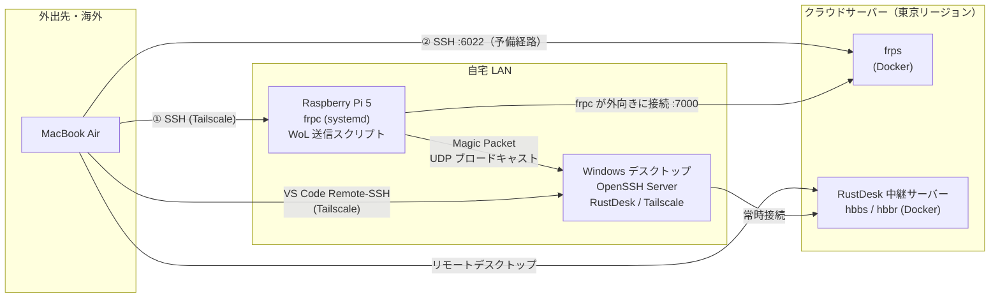
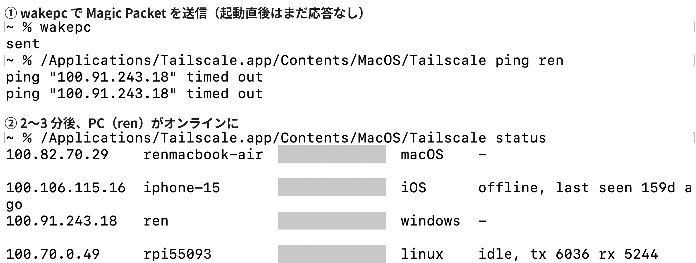
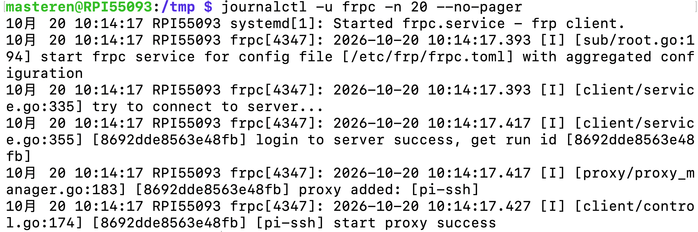
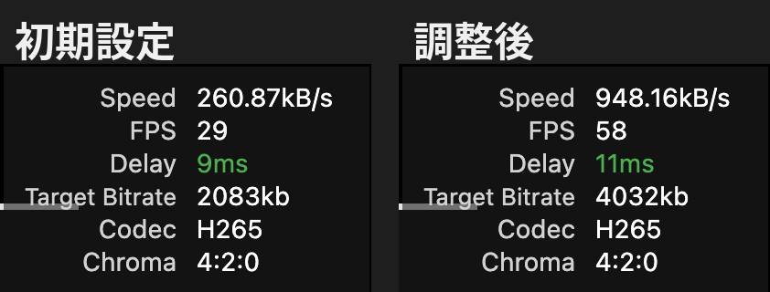
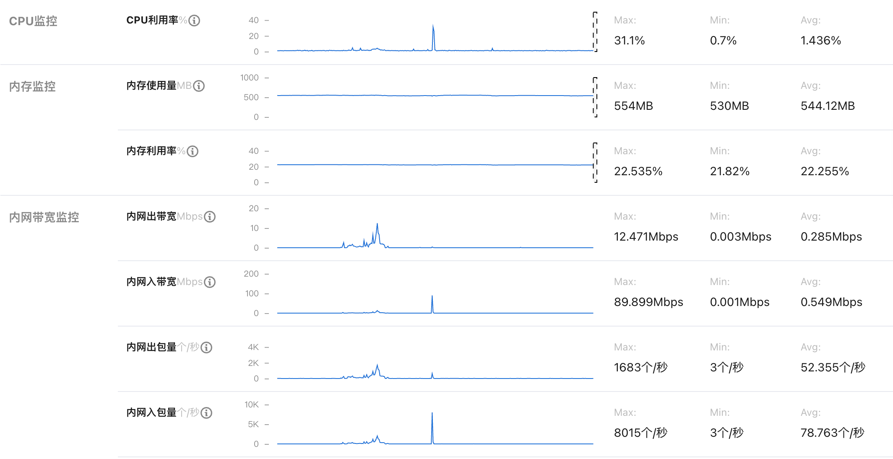
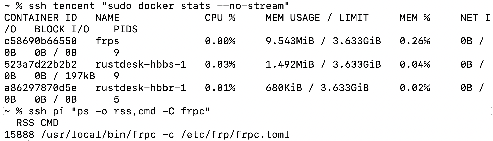

# home-remote-dev-env

海外滞在中でも日本の自宅 PC で開発を続けるための、**遠隔起動・リモート開発・リモートデスクトップ環境**の設計・構築記録です。

Raspberry Pi による Wake-on-LAN、Tailscale（WireGuard ベースの VPN）、クラウドサーバー上に自前で構築した frp と RustDesk 中継サーバーを組み合わせ、**VPN が使えない状況でも別経路で起動・接続できる**構成にしています。

> 既存のオープンソースソフトウェアを組み合わせた**インフラ構築プロジェクト**です。各コンポーネントの選定理由と、構築中に発生した問題の切り分け過程も記録しています。

---

## 目次

- [背景と目的](#背景と目的)
- [システム構成](#システム構成)
- [できること](#できること)
- [設計上の判断](#設計上の判断)
- [セキュリティ対策](#セキュリティ対策)
- [検証結果](#検証結果)
- [使用技術](#使用技術)
- [ディレクトリ構成](#ディレクトリ構成)
- [今後の課題](#今後の課題)

---

## 背景と目的

一時帰国中（約 3 週間）も、日本の自宅にある Windows デスクトップで開発作業を継続したいと考えました。

要件は以下の 4 点です。

1. **遠隔起動**：普段は電源を切っておき、必要なときだけ外部から起動する
2. **リモート開発**：VS Code から SSH で接続し、コードの実行やビルドは自宅 PC 側で行う
3. **リモートデスクトップ**：GUI アプリも操作できる
4. **冗長性**：特定のサービス（VPN など）が海外から使えなくなっても、別経路で起動・接続できる

---

## システム構成



| 役割 | 主経路 | 予備経路 |
|---|---|---|
| 遠隔起動 | Tailscale → Raspberry Pi → WoL | 自前サーバーの frp → Raspberry Pi → WoL |
| リモート開発 | VS Code Remote-SSH（Tailscale 経由） | リモートデスクトップ上の VS Code |
| リモートデスクトップ | RustDesk（自前中継サーバー経由） | — |
| シャットダウン・スリープ | SSH でコマンド実行 | リモートデスクトップから操作 |

---

## できること

Mac のターミナルから、以下のコマンドだけで操作できます（定義は [`mac/aliases.zsh`](mac/aliases.zsh)）。

```bash
wakepc     # 遠隔起動（Tailscale 経由）
wakepc2    # 遠隔起動（frp 経由・予備）
pcstatus   # PC がオンラインか確認
shutpc     # シャットダウン
sleeppc    # スリープ
```

起動後は VS Code の Remote-SSH で `winpc` に接続して開発し、GUI が必要な場合は RustDesk で接続します。

<!-- スクリーンショット：遠隔起動の流れ -->


---

## 設計上の判断

### なぜ Raspberry Pi を経由して起動するのか

Wake-on-LAN の Magic Packet は **L2 ブロードキャスト**で送信されるため、インターネット越しに直接届けることはできません。そこで、自宅 LAN 内で常時稼働している Raspberry Pi に SSH で接続し、LAN 内からパケットを送信する構成にしました。

### なぜ予備経路（frp）を用意したのか

Tailscale は自前サーバーを持たずに NAT 越えの VPN を構築できる一方、ログインや鍵の配布を Tailscale 社のコントロールプレーンに依存しています。海外のネットワーク環境では接続が不安定になる可能性があるため、**自分で管理しているクラウドサーバーだけで完結する経路**を frp で追加しました。

frpc は Raspberry Pi から**外向きに**接続を張るため、自宅ルーターのポート開放は不要です。



### なぜ RustDesk の中継サーバーを自前で構築したのか

| 候補 | 判断 |
|---|---|
| Windows 標準のリモートデスクトップ（RDP） | 文字の表示がきれいで低帯域だが、RDP ポートはインターネットに公開できないため VPN が前提になる。VPN が使えない状況でも接続できる手段が別に必要 |
| Chrome リモートデスクトップ | Google のサービスに依存するため、海外のネットワーク環境によっては利用できない |
| 公開中継サーバー型のリモートデスクトップサービス | 無料プランでは画質・機能に制限がある |
| **RustDesk + 自前中継サーバー** | 通信経路を自分で管理でき、画質の上限はサーバーの帯域のみで決まる |

中継サーバーを自宅と同じ東京リージョンに置くことで、自宅側の区間の遅延を抑えています。

### なぜ frpc を Docker ではなく systemd で動かすのか

frpc は**予備経路の要**であり、障害点はできるだけ減らしたいと考えました。Docker をアンインストールした際に動かなくなった経験から、単一バイナリを systemd サービスとして登録し、OS 起動時に自動で立ち上がるようにしています。

### Windows 側の起動直後の接続性

- Tailscale を **unattended モード**で動かし、ユーザーがログインする前から接続できるようにしています
- Tailscale のサービスを**遅延自動起動**にし、ネットワークの初期化が終わってから接続を開始するようにしています
- RustDesk も**サービスとして**インストールし、ログイン画面の状態でも接続できるようにしています
- AC 電源接続時の**自動スリープを無効化**し、リモート開発中に SSH 接続が切れないようにしています。使い終わったら `shutpc` で明示的にシャットダウンします

---

## セキュリティ対策

外部に公開するポートが増えるため、以下を実施しています。

- **SSH は公開鍵認証のみ**：frp で外部公開している Raspberry Pi の SSH はパスワード認証を無効化
- **frp のトークン認証**：トークンを知らないクライアントは frps に接続できない
- **公開ポートの最小化**：クラウドサーバーのファイアウォールで、必要なポート以外を閉じる。使用していない RDP（3389）の許可ルールは削除
- **RDP は外部に公開しない**：Windows の RDP ポートは公開せず、VPN または SSH 経由でのみ利用
- **秘密情報をリポジトリに含めない**：IP アドレス・トークン・鍵などは `*.example` のプレースホルダーに置き換え、実際の設定ファイルは `.gitignore` で除外

---

## 検証結果

日本国内（自宅とは別のネットワーク）から接続して計測しました。

### リモートデスクトップ（RustDesk、自前中継サーバー経由）

| 項目 | 初期設定 | 調整後 |
|---|---|---|
| フレームレート | 29 fps | **58 fps** |
| 遅延 | 9 ms | **11 ms** |
| 実効ビットレート | 約 2.1 Mbps | 約 7.6 Mbps |
| コーデック | H.265（GPU ハードウェアエンコード） | 同左 |

画質設定のビットレート上限を引き上げることで、遅延をほぼ変えずにフレームレートを約 2 倍にできました。中継サーバーのログから、通信が自前サーバー経由で中継されていることも確認しています。

<!-- スクリーンショット：RustDesk の品質モニター -->


### リソース使用量

| ホスト | プロセス | メモリ | CPU |
|---|---|---|---|
| Raspberry Pi 5 | frpc | 約 15.5 MB | ほぼ 0% |
| クラウドサーバー | frps | 約 9.5 MB | 0% |
| クラウドサーバー | RustDesk hbbs + hbbr | 約 2.2 MB | ほぼ 0% |

常駐させても、既存サービスへの影響はほぼありません。

クラウドサーバーの監視画面（構築・検証時）では、CPU 使用率は平均 1.4%、メモリ使用率は約 22% で推移しました。帯域のピークは、リモートデスクトップで動画を再生して画質を検証したときのものです。



<!-- スクリーンショット：リソース使用量 -->


---

## 使用技術

| 分類 | 技術 |
|---|---|
| ネットワーク | Wake-on-LAN、Tailscale（WireGuard）、frp（リバーストンネル）、RustDesk |
| サーバー | Ubuntu 22.04（クラウド）、Raspberry Pi OS（Debian） |
| コンテナ・サービス管理 | Docker、Docker Compose、systemd |
| リモート接続 | OpenSSH（Windows / Linux）、VS Code Remote-SSH |
| スクリプト | Python 3、PowerShell、zsh |

---

## ディレクトリ構成

```
.
├── README.md
├── docs/
│   ├── setup.md              # 構築手順
│   ├── troubleshooting.md    # 構築中に発生した問題と対応
│   └── images/               # スクリーンショット
├── windows/
│   ├── setup-wol.ps1         # NIC の Wake-on-LAN 設定
│   ├── setup-openssh.ps1     # OpenSSH Server の導入と公開鍵登録
│   └── install-rustdesk.ps1  # RustDesk を SSH 経由でサイレントインストール
├── raspberry-pi/
│   ├── wakepc.py             # Magic Packet 送信スクリプト
│   ├── test_wakepc.py        # 上記のユニットテスト
│   ├── frpc.toml.example
│   ├── frpc.service          # systemd ユニット
│   └── sshd-no-password.conf
├── server/
│   ├── frp/frps.toml.example
│   └── rustdesk/compose.yml
└── mac/
    ├── ssh_config.example
    └── aliases.zsh
```

構築手順は [docs/setup.md](docs/setup.md)、構築中に発生した問題は [docs/troubleshooting.md](docs/troubleshooting.md) にまとめています。

---

## 今後の課題

- **起動の単一障害点**：Raspberry Pi が自宅 LAN にない場合、遠隔起動ができない。スマートプラグと BIOS の「通電時に自動起動」を組み合わせた第 3 の起動経路を検討中
- **ヘッドレス運用**：モニターの電源を切ると GPU の出力が止まり、リモートデスクトップの画面が映らなくなる場合がある。HDMI ダミープラグで対策予定
- **死活監視**：PC・Raspberry Pi・中継サーバーの状態を確認し、異常時に通知する仕組み
- **VPN の自前化**：Tailscale の DERP 中継サーバー、または Headscale をクラウドサーバー上に構築し、外部サービスへの依存をさらに減らす

---

## ライセンス

[MIT](LICENSE)
